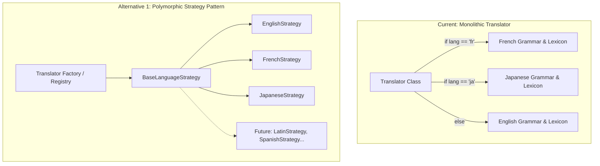

# Architectural Design Review: Internationalization (i18n) and Translation System

**Date:** 2026-11-14  
**Project:** `tridentine_calendar`  
**Target Codebase:** `tridentine_calendar/i18n/`, `tridentine_calendar/tridentine_calendar.py`, `tridentine_calendar/utils.py`  
**Author:** Antigravity Agent  

---

## Executive Summary

The internationalization (i18n) system in `tridentine_calendar` provides localization for English (`en`), French (`fr`), and Japanese (`ja`). While functional for existing features, the current implementation is built on an ad-hoc, monolithic `Translator` class with tightly coupled, language-specific branching (`if self.lang == ...`), hardcoded grammatical heuristics, and leaky abstractions in core calendar logic.

This review assesses the current architecture, identifies key technical debt and failure modes (including root causes of recent test breakages), evaluates four alternative design paradigms, and proposes a concrete, phased migration to a **Polymorphic Language Strategy Pattern** paired with standardized, UTF-8-normalized tabular lexicons.

---

## 1. Current State Assessment

### 1.1 Structural Overview

The i18n subsystem is organized as follows:

```
tridentine_calendar/
├── i18n/
│   ├── __init__.py
│   ├── translator.py          # Monolithic Translator class (all languages & grammar)
│   ├── fr/
│   │   ├── class_lexicon.csv  # Rank translations (Ire classe, etc.)
│   │   ├── color_lexicon.csv  # Liturgical colors
│   │   ├── feasts_seasons.csv # Feast & season names (UTF-8, 2 columns)
│   │   └── titles_lexicon.csv # Saint titles (pape, évêque, etc.)
│   └── ja/
│       ├── class_lexicon.csv  # Rank translations (1級, etc.)
│       ├── color_lexicon.csv  # Liturgical colors
│       ├── feasts_seasons.csv # Feast & season names (Shift-JIS, 9 columns)
│       ├── titles_lexicon.csv # Saint titles
│       ├── fixed_feasts_local.csv   # Japan-specific feasts (loaded outside Translator)
│       ├── fixed_feasts_missing.csv # Japan-specific commemorations
│       └── movable_feasts_local.csv # Japan-specific movable feasts
```

### 1.2 Core Architectural Patterns in `Translator`

1. **Monolithic Class with Language-Switching Branches:**
   The `Translator` class in [`tridentine_calendar/i18n/translator.py`](file:///home/joe/code/tridentine_calendar/tridentine_calendar/i18n/translator.py) centralizes template definitions, dictionary loading, number/ordinal generation, morphosyntactic adjustments (pluralization, contractions), and formatting. Almost every method contains conditionals checking `self.lang`:
   - `__init__`: branches to `_load_ja()` or `_load_fr()`.
   - `_load_ordinals()` and `_load_weekdays()`: branches on `ja`, `fr`, or `else` (English).
   - `format_feast_full_name()`: independent blocks for Japanese, French, and English logic.
   - `format_class_feria()`, `format_color()`, `format_outranking()`, `format_titles()`: language-specific formatting and grammar replacements.

2. **In-Code Grammatical Rules & Heuristics:**
   - **French:**
     - Preposition and article contraction/elision (`_contract()`): 40 lines of regular expressions and string replacements (`de le` $\rightarrow$ `du`, `de les` $\rightarrow$ `des`, `de [vowel]` $\rightarrow$ `d'[vowel]`, double-article deduplication).
     - Plural detection (`_is_plural()`): hardcoded string prefix matching on `Les `, `les `, `Sts `, `Stes `.
     - Plural verb/adjective agreement: inline string replacement in generic methods (`replace(' est ', ' sont ')`, `replace(' omise.', ' omises.')`, `replace(' n\'a pas ', ' n\'ont pas ')`).
     - Compound title pluralization (`_pluralize_fr_title()`): string splitting on ` et ` and ` de `.
   - **English:**
     - Feast prefix heuristics: `the_feast_of_prefixes = ['St.', 'SS.', 'Pope', 'Our Lady', 'The']`, `name.split()[0] in ['Basilica', 'Baptism', 'Church']`.
     - Capitalization heuristics: `make_initial__the__lowercase()` in [`utils.py`](file:///home/joe/code/tridentine_calendar/tridentine_calendar/utils.py#L197-L202).

3. **Inconsistent Resource Loading and Encodings:**
   - Resource loading uses `importlib.resources.files` in `Translator._load_csv()`, but falls back to the deprecated `resources.read_binary()` in `LiturgicalCalendar._load_extra_ja_feasts()`.
   - Encoding inconsistency: French CSV files are UTF-8; Japanese CSV files are Shift-JIS (`shift_jis`). In a modern Python 3 codebase, Shift-JIS causes terminal rendering glitches, complicates git diffs, and requires language-specific decode branching.
   - Schema divergence: `fr/feasts_seasons.csv` has 2 columns (`en,fr`), whereas `ja/feasts_seasons.csv` has 9 columns (`file,path,dates_en,dates_ja,en,ja,url 1,url 2,notes`).

4. **Leaky Abstractions Across Subsystem Boundaries:**
   - In [`tridentine_calendar/tridentine_calendar.py`](file:///home/joe/code/tridentine_calendar/tridentine_calendar/tridentine_calendar.py#L643-L710), `LiturgicalCalendar` has a private method `_load_extra_ja_feasts()` dedicated exclusively to parsing Japanese-specific local feast CSVs, directly mutating the internal `self.translator.translations` dictionary.
   - In [`tridentine_calendar/tridentine_calendar.py`](file:///home/joe/code/tridentine_calendar/tridentine_calendar/tridentine_calendar.py#L762-L765), ICS calendar generation directly invokes `self.translator._contract(ics_name)` for French, exposing private internal formatting helpers across module boundaries.
   - In [`tridentine_calendar/tridentine_calendar.py`](file:///home/joe/code/tridentine_calendar/tridentine_calendar/tridentine_calendar.py#L585-L590), liturgical year construction contains an explicit check `if self.lang == 'fr': ...` to determine how to format the 5th Sunday of Easter.

---

## 2. Assessment: Is the Current Design Appropriate?

### 2.1 The Verdict: Not Appropriate for Ongoing Maintenance or Expansion

While the current design was reasonable as a quick, zero-dependency prototype when only English and Japanese were supported, it has reached the limits of its scalability. 

The recent test failure was a direct consequence of this architecture:
1. **Coupling caused merge fragility:** Two concurrent branches touched the same monolithic method (`format_feast_full_name`), one attempting to handle contractions systematically and the other attempting to handle non-feasts and Sundays via ad-hoc substring checks. The resulting merge was semantically invalid, leading to a fatal `KeyError`.
2. **Grammar bleeding:** French-specific string replacements (`.replace(' est ', ' sont ')`) sit directly inside general formatting routines. Adding Latin (inflected cases: nominative, genitive, ablative), Spanish, or German would multiply this complexity exponentially.
3. **Open/Closed Principle (OCP) Violation:** Adding a fourth language requires modifying dozens of locations across `translator.py`, `tridentine_calendar.py`, and `utils.py`, increasing regression risks for all existing languages.

---

## 3. Alternative Design Options

Below are four alternative designs evaluated for `tridentine_calendar`.



---

### Alternative 1: Polymorphic Language Strategy Pattern (Recommended)

#### Description
Decompose the monolithic `Translator` into an abstract base class (`LanguageStrategy` or `BaseLanguageFormatter`) with concrete implementations for each supported language (`EnglishStrategy`, `FrenchStrategy`, `JapaneseStrategy`). A lightweight `Translator` factory retains the existing public interface (`Translator(lang='en')`), returning or delegating to the appropriate strategy.

Each strategy encapsulates:
- Formatting templates specific to the language.
- Ordinal, weekday, and number formatting.
- Grammar-specific behaviors (e.g., French article contractions and elisions, English prefix heuristics, Japanese particle attachments).
- Language-specific local feast loading hooks (e.g. moving `_load_extra_ja_feasts` into `JapaneseStrategy`).

#### Pros
- **Strict Open/Closed Principle:** Adding Latin or Spanish requires creating a new strategy file without modifying existing languages.
- **Zero External Dependencies:** Built entirely with standard library Python (`abc`, `importlib.resources`, `csv`).
- **Full Backward Compatibility:** The public API (`translator.translate()`, `translator.format_feast_full_name()`, etc.) remains identical.
- **Isolated Testing:** Each language's grammar rules can be tested in focused unit tests without interference.
- **Encapsulates Linguistic Divergence:** High-inflection languages (Latin) or elision-heavy languages (French, Italian) can have rich logic without polluting simple analytic languages (English).

#### Cons
- Increases the number of files/classes in `tridentine_calendar/i18n/`.
- Requires an initial refactoring pass across `translator.py`.

---

### Alternative 2: GNU gettext / Babel Standard (`.po` / `.mo`)

#### Description
Adopt the standard Unix/Python gettext infrastructure using `.po` text catalogs compiled into binary `.mo` catalogs, wrapped with `gettext` or `Babel`.

#### Pros
- Standardized toolchain across software engineering (POEdit, Weblate, Crowdin).
- Built-in pluralization handling via `ngettext`.
- Well-understood by non-programmer translators.

#### Cons
- **Ill-suited for Liturgical Morphology:** Gettext assumes static string substitution with simple numeric plural categories. It provides no mechanism for French contraction rules (`de` + `le` $\rightarrow$ `du`), elision (`de` + `l'Avent`), or Latin noun declension (`Festum Sancti Joseph` vs `Sanctus Joseph`).
- **Tabular Data Mismatch:** The calendar relies on thousands of tabular feast definitions (`feasts_seasons.csv`, rank lexicons, title lexicons). Converting tabular databases into sprawling `.po` message files creates maintenance overhead and loses tabular data integrity.
- **Build/Packaging Friction:** Requires a compilation step (`msgfmt`) during package build and distribution, complicating the lightweight `pip install` packaging workflow.

---

### Alternative 3: Project Fluent / ICU MessageFormat

#### Description
Migrate to Mozilla's Project Fluent (`fluent.runtime`) or Unicode ICU MessageFormat (`pyicu`). Localizations are stored in `.ftl` or `.properties` files with built-in grammatical selectors, variant forms, and attribute references.

#### Pros
- **Asymmetric Grammar Expression:** Fluent allows translators to define grammatical gender and grammatical cases in localization files without backend code changes. For example, in French, terms can carry gender and article properties directly in the `.ftl` file.
- Clean separation between code and translation.

#### Cons
- **External Runtime Dependency:** Requires adding `fluent.runtime` or `pyicu` to `install_requires`. `pyicu` requires C++ ICU libraries installed on the host OS, making installation painful in lightweight or cross-platform environments.
- **Steep Learning Curve:** Syntax for complex Fluent selectors can be difficult for casual contributors.
- **Doesn't Eliminate Complex Rule Code:** Even with Fluent, programmatic liturgical calendar rules (such as ranking outranking, computus combinations, and dynamic titular suffixes) still require extensive Python orchestration.

---

### Alternative 4: Fully Declarative Data-Driven Configuration (YAML/JSON Rules Engine)

#### Description
Eliminate procedural code in `Translator` by declaring all templates, ordinals, pronouns, elisions, and contraction regexes in a unified declarative schema (e.g. `fr.json`, `ja.json`). A single generic engine interprets these rules.

#### Pros
- New languages can theoretically be contributed purely via JSON/YAML files without writing Python code.
- Unified storage format.

#### Cons
- **Inventing a Fragile Domain-Specific Language (DSL):** Natural languages possess complex, irregular exceptions. Attempting to encode French elision, German compound cases, or Latin declensions declaratively in JSON inevitably results in a clumsy, bug-prone mini-interpreter.
- Debugging grammatical failures becomes far harder than stepping through straightforward Python code.

---

## 4. Comparative Evaluation Matrix

| Criteria | Current Monolithic | Alt 1: Polymorphic Strategy (Recommended) | Alt 2: GNU gettext | Alt 3: Project Fluent | Alt 4: Declarative Rules |
| :--- | :---: | :---: | :---: | :---: | :---: |
| **Extensibility (Adding new languages)** | ❌ Poor (Touches all files) | ✅ Excellent (Add new class) | ⚠️ Moderate | ✅ Good | ⚠️ Moderate |
| **Grammar & Morphology Handling** | ⚠️ Fragile (String replace) | ✅ Strong (Language-specific code) | ❌ Poor (Rigid substitution) | ✅ Very Strong | ❌ Poor / Overly Complex |
| **Zero Runtime Dependencies** | ✅ Yes | ✅ Yes | ✅ Yes (Standard lib) | ❌ No (Requires external libs) | ✅ Yes |
| **Tabular Feast Data Ergonomics** | ✅ Good (CSVs) | ✅ Good (Standardized CSV/JSON) | ❌ Poor (Bloated PO files) | ⚠️ Moderate | ⚠️ Moderate |
| **Maintainability & Clean Architecture** | ❌ Low (High coupling) | ✅ High (SOLID / OCP) | ⚠️ Moderate | ✅ High | ⚠️ Moderate |
| **Backward Compatibility Impact** | N/A | ✅ 100% Compatible | ❌ High breaking change | ❌ High breaking change | ⚠️ Medium breaking change |

---

## 5. Architectural Recommendation & Opinion

### Recommendation: Polymorphic Language Strategy Pattern

The **Polymorphic Language Strategy Pattern (Alternative 1)** is unequivocally the best architectural fit for `tridentine_calendar`.

#### Rationale:
1. **Pragmatism Over Over-Engineering:** A liturgical calendar is a specialized domain. Its linguistic requirements are neither simple key-value lookups (which gettext does well) nor arbitrary user interface translations (which Fluent does well). It is a domain of specific syntactic templates combined with idiosyncratic ecclesiastical Latin/vernacular grammar rules.
2. **Encapsulation of Natural Language Quirks:** In Python, writing 25 lines of clear, regex-backed, well-tested Python code in `FrenchStrategy` (to handle `de` + `le` $\rightarrow$ `du` and elision) is vastly superior to wrestling with gettext's inability to contract articles or building an awkward JSON declarative grammar engine.
3. **Preservation of Standalone Packaging:** The library remains completely dependency-free, pure Python.
4. **Fixing Leaky Abstractions:** Language-specific domain hooks (such as Japan's local feasts) move naturally into `JapaneseStrategy`, cleansing `tridentine_calendar.py` of locale-specific logic.

---

## 6. Target Architecture & Implementation Plan

### 6.1 Proposed Target Structure

```
tridentine_calendar/i18n/
├── __init__.py                # Exports Translator facade
├── base.py                    # BaseLanguageStrategy (ABC)
├── factory.py                 # Registry & factory for strategies
├── strategies/
│   ├── english.py             # EnglishStrategy
│   ├── french.py              # FrenchStrategy (contractions, elision, pluralization)
│   └── japanese.py            # JapaneseStrategy (Shift-JIS/UTF-8 conversion, particles, local feasts)
└── data/
    ├── fr/                    # Standardized UTF-8 CSVs (en, local, notes)
    └── ja/                    # Standardized UTF-8 CSVs
```

### 6.2 Proposed Strategy Interface (`base.py`)

```python
from abc import ABC, abstractmethod
from typing import List, Optional

class BaseLanguageStrategy(ABC):
    """Abstract base strategy for language-specific translation and formatting."""

    lang_code: str

    @abstractmethod
    def translate(self, text: str) -> str:
        """Translate a single term or return the original text."""
        pass

    @abstractmethod
    def format_feast_full_name(
        self, name: str, rank: int, titles: Optional[List[str]] = None, is_feast: bool = True
    ) -> str:
        """Format the full display name of a feast or liturgical day."""
        pass

    @abstractmethod
    def format_class_feria(self, name: str, rank: int, is_feast: bool) -> str:
        """Format class description (e.g. 'Class I feast')."""
        pass

    @abstractmethod
    def format_color(self, color: str) -> str:
        """Format liturgical color announcement."""
        pass

    @abstractmethod
    def format_titles(self, titles: List[str], plural: bool = False) -> str:
        """Format and join saintly titles."""
        pass

    @abstractmethod
    def get_ordinal(self, n: int) -> str:
        """Return the localized ordinal for an integer."""
        pass

    def load_local_calendar_feasts(self, calendar_builder, year: int) -> None:
        """Optional hook for region/language-specific local feasts (e.g., Japan)."""
        pass
```

### 6.3 Phased Implementation Roadmap

1. **Phase 1: Data Normalization (Low Risk)**
   - Re-encode `i18n/ja/*.csv` from Shift-JIS to UTF-8.
   - Standardize column headers across language CSVs (`en,translated,notes`).

2. **Phase 2: Extract Strategies (Zero Breaking API Changes)**
   - Create `BaseLanguageStrategy` with shared dictionary loading logic.
   - Implement `EnglishStrategy`, `FrenchStrategy` (incorporating `_contract`, `_pluralize_fr_title`, and agreement rules), and `JapaneseStrategy`.
   - Update `Translator` in [`translator.py`](file:///home/joe/code/tridentine_calendar/tridentine_calendar/i18n/translator.py) to become a factory/delegator pattern so that all existing tests and external consumers experience zero API breakage.

3. **Phase 3: Clean Up Core Leaks**
   - Relocate `_load_extra_ja_feasts()` from `LiturgicalCalendar` into `JapaneseStrategy.load_local_calendar_feasts()`.
   - Remove language checks (`if self.lang == 'fr': ...`) from [`tridentine_calendar.py`](file:///home/joe/code/tridentine_calendar/tridentine_calendar/tridentine_calendar.py) and [`utils.py`](file:///home/joe/code/tridentine_calendar/tridentine_calendar/utils.py), delegating formatting choices directly to the active strategy.
